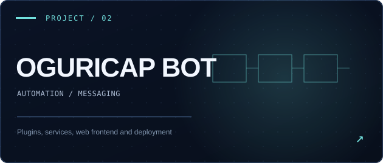
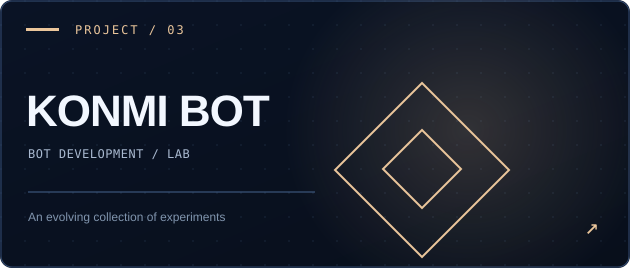

<div align="center">

<a href="https://sebasloadjs.github.io/SebasLoadJs/">
  
</a>

<br />

**` 𝚂𝚎𝚋𝚊𝚜 `** &nbsp; **·** &nbsp; `DEVELOPER / OPEN SOURCE / PARAGUAY`

<br />

<a href="https://sebasloadjs.github.io/SebasLoadJs/"></a>&nbsp;
<a href="https://github.com/SebasLoadJs?tab=repositories"></a>&nbsp;
<a href="https://github.com/SebasLoadJs/NyxLink"></a>

<br />

<sub>Software isn't only what people see. It's what makes everything work.</sub>

</div>

<br />


<table>
<tr>
<td width="58%" valign="top">

### Hey, I'm Sebas. <code>↗</code>

Soy **Sebas**, desarrollador de Paraguay. Exploro la arquitectura detrás de aplicaciones de Discord, clientes de audio, automatizaciones, APIs y herramientas para desarrolladores.

I enjoy working with the less visible parts of software: **systems, integrations, developer experience and maintainable architecture**.

Más que una lista de tecnologías, este perfil reúne proyectos reales, su código y las decisiones técnicas que vale la pena estudiar.

</td>
<td width="42%" valign="top">

**`developer.config.ts`**

<pre><code>const developer = {
  name: "Sebas",
  location: "Paraguay",
  focus: [
    "audio systems",
    "Discord ecosystem",
    "software architecture",
    "developer tooling"
  ],
  approach: "research → build → refine"
} as const;</code></pre>

</td>
</tr>
</table>

<br />


<div align="center">

### Selected work / Proyectos destacados

<sub>REAL REPOSITORIES · DIFFERENT SYSTEMS · CONTINUOUS ITERATION</sub>

</div>

<br />

<table>
<tr>
<td width="50%" valign="top">
  <a href="https://github.com/SebasLoadJs/NyxLink"></a>
  <h3>01 — NyxLink</h3>
  <p>Audio client for Discord bots, working with <strong>Lavalink v4</strong> and <strong>NodeLink</strong>. Includes implementation modules, automated tests and examples.</p>
  <p><code>TypeScript</code> <code>Audio</code> <code>Library</code></p>
  <p><a href="https://github.com/SebasLoadJs/NyxLink"><strong>Explore repository ↗</strong></a></p>
</td>
<td width="50%" valign="top">
  <a href="https://github.com/SebasLoadJs/OguriCap-Bot"></a>
  <h3>02 — OguriCap Bot</h3>
  <p>WhatsApp automation project with plugin infrastructure, independent frontend, backend services and deployment files.</p>
  <p><code>Automation</code> <code>Node.js</code> <code>Plugins</code></p>
  <p><a href="https://github.com/SebasLoadJs/OguriCap-Bot"><strong>Explore repository ↗</strong></a></p>
</td>
</tr>
<tr>
<td colspan="2" align="center" valign="top">
  <a href="https://github.com/SebasLoadJs/KONMI-BOT-"></a>
  <h3>03 — KONMI BOT</h3>
  <p>Another part of my bot-development experiments. Consult the public repository for the implementation and its current state.</p>
  <p><code>Bot</code> <code>Experimental</code></p>
  <p><a href="https://github.com/SebasLoadJs/KONMI-BOT-"><strong>Explore repository ↗</strong></a></p>
</td>
</tr>
</table>

<br />


### Behind the repository / Dentro de los sistemas

El código puede decir más que una lista de badges. Estas son algunas de las estructuras verificadas en mis repositorios:

<details>
<summary><strong>✳ NyxLink — audio infrastructure</strong> &nbsp; <code>OPEN SOURCE / IN DEVELOPMENT</code></summary>
<br />

```text
NyxLink/
├── src/             implementation modules
├── tests/           automated tests
├── examples/        usage examples
├── scripts/         development utilities
├── dist/            distributable package
├── index.ts         entry point
├── package.json     package metadata
└── tsconfig.json    TypeScript configuration
```

Current package metadata: `0.1.0-dev.2`; Node.js `>=22.12.0`. Documentation covers playback, track metadata, player and node management. Features remain subject to testing and development status.

[Source](https://github.com/SebasLoadJs/NyxLink) · [Tests](https://github.com/SebasLoadJs/NyxLink/tree/v5.2/tests) · [Examples](https://github.com/SebasLoadJs/NyxLink/tree/v5.2/examples)

</details>

<details>
<summary><strong>✳ OguriCap Bot — automation and services</strong></summary>
<br />

```text
OguriCap-Bot/
├── plugins/          plugin modules
├── services/         backend services
├── frontend-next/    separate frontend
├── database/         database files
├── lib/              shared utilities
├── test/             tests
├── nginx/            server configuration
└── docker-compose.yml
```

[Source](https://github.com/SebasLoadJs/OguriCap-Bot)

</details>

<br />

### An audio client, conceptually

<a href="https://github.com/SebasLoadJs/NyxLink">
  
</a>

<sub>Illustrative component diagram. It does not claim a live deployment, streaming traffic, or validated automatic failover.</sub>

<br /><br />


<div align="center">

### TECH / TOOLKIT

<sub>Technologies found in the repositories and current areas of exploration</sub>

<br /><br />


<br /><br />

`discord.js` &nbsp; `REST APIs` &nbsp; `WebSockets` &nbsp; `Lavalink` &nbsp; `NodeLink` &nbsp; `Docker`

`Testing` &nbsp; `Documentation` &nbsp; `Modular architecture` &nbsp; `Developer experience`

</div>

<br />

### The way I approach development

| Discipline | What matters |
|:--|:--|
| `01` Architecture | Clear responsibilities and interfaces before adding complexity |
| `02` Testing | Verifying important paths, failures and regressions |
| `03` Documentation | Making projects understandable to someone new |
| `04` Operations | Configuration, deployment and maintenance as part of engineering |
| `05` Iteration | Research → build → evaluate → refine |

<br />


<div align="center">

### Explore the work beyond this README.

This profile is the index. The portfolio contains more context, an interactive project explorer and public GitHub data when the API is available.

<br />

<a href="https://sebasloadjs.github.io/SebasLoadJs/"></a>
<a href="https://github.com/SebasLoadJs?tab=repositories"></a>

<br /><br />

<sub>SEBAS © 2026 · SOFTWARE / SYSTEMS / SOUND · BUILD / EXPLORE / REFINE</sub>

</div>